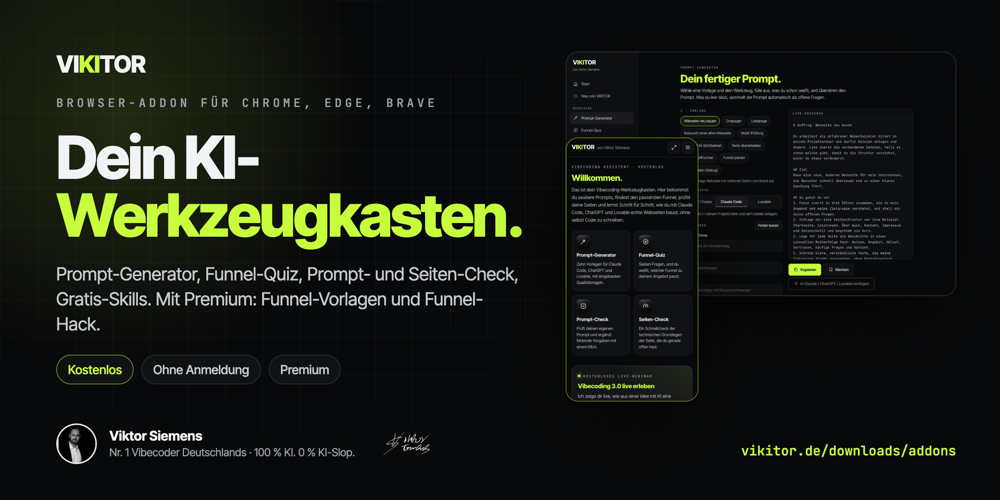

<p align="center"></p>

# VIKITOR Vibecoding Assistent – dein KI-Werkzeugkasten im Browser

**Kostenloses Browser-Addon von Viktor Siemens (VIKITOR)** für Chrome, Edge und Brave. Saubere Prompts, der passende Funnel, geprüfte Seiten und Anleitungen, immer griffbereit neben Claude Code, Codex, ChatGPT und Lovable. Aktuelle Version: **v1.5.0**.

**➜ [Kostenlos herunterladen](https://vikitor.de/downloads/addons/)** · [Updates](https://vikitor.de/updates/) · [Vibecoding Masterclass (inkl. Premium)](https://vikitor.de/angebot/vibecoding-masterclass/)

## Funktionen

| Werkzeuge | Premium | Lernen | Mehr |
|---|---|---|---|
| Prompt-Generator, Funnel-Quiz, Prompt-Check, Seiten-Check | Funnel-Vorlagen, Funnel-Hack | Gratis-Skills, Anleitungen, Merkliste | Neu von VIKITOR (News, Ratgeber, Updates, Events), Downloads, Masterclass & Shop |

**Premium** (gleicher Freischaltcode wie VS MAC OS, enthalten in der Vibecoding 3.0 Masterclass, Code persönlich per WhatsApp): fertige Funnel-Baupläne als Auftrag an die KI und der **Funnel-Hack**, der die Struktur einer erfolgreichen Seite erfasst und das Muster mit eigenen Texten auf dein Angebot überträgt. Neu in 1.5.0: **Funnel mitschneiden** – du klickst selbst durch einen Funnel, jede Seite wird als Ganzseiten-Screenshot mit Struktur erfasst und am Ende als ZIP im Format der Scan-Engine (`~/Developer/vs-funnel-scan/SCHEMA.md`: `funnelhack/funnel.json`, `design-tokens.css`, `index.html`, je Schritt Screenshots, `page.json`, `text.md`, `design.json`, `tech.json`) heruntergeladen, importierbar in VS MAC OS und VS WIN OS. Die Analyse-Module liegen als Kopie der Engine in `src/js/engine/` (aktualisieren mit `node scripts/sync-engine.mjs`). Im Browser nicht messbar und deshalb leer/null: Mobil-Emulation, Scroll-Videos, Server-Header, Cookie-Banner-Wahl. Regel: sehr nah modellieren, aber Texte, Bilder und Marke immer eigen.

---

## Entwicklung

Kostenlose Chrome-Erweiterung von Viktor Siemens (Marke VIKITOR, https://vikitor.de) für Leads und Webinar-Teilnehmer. Der Assistent öffnet sich als Seitenleiste neben jeder Webseite und zusätzlich als große Ansicht in einem eigenen Tab.

**Funktionen:** Start mit Live-Call-Hinweis, Prompt-Generator (10 Vorlagen × 4 Werkzeuge: Claude Code, Codex, ChatGPT, Lovable), Funnel-Quiz (7 Fragen, 6 Funnel-Typen), Prompt-Check (regelbasiert, ohne Server), Seiten-Check (Schnellcheck auf Knopfdruck), drei Gratis-Skills für Claude Code und Codex, Anleitungen, Merkliste, Masterclass & Shop und „Über Viktor“.

**Werkzeuge im Generator:** Claude Code und Codex bekommen denselben Arbeitsauftrag im Projektordner (Codex liest zusätzlich die `AGENTS.md`, Skills liegen unter `~/.codex/skills`, Aufruf über `/skills` oder im Auftrag). ChatGPT im Browser bleibt Planer und Texter ohne Code, Lovable arbeitet in kleinen Schritten.

Technik: Manifest V3, reines HTML, CSS und JavaScript (ES-Module) ohne Build-Schritt.

### Ordnerstruktur

```
vikitor-addon/
├── src/                    ← die Erweiterung (dieser Ordner wird geladen bzw. gepackt)
│   ├── manifest.json
│   ├── background.js       ← Service Worker: Seitenleiste, Kontextmenü, Willkommens-Tab
│   ├── content.js          ← nur claude.ai, chatgpt.com, lovable.dev: fügt Prompts ein
│   ├── app.html            ← eine App für Seitenleiste (?view=panel) und Tab (?view=tab)
│   ├── css/app.css         ← Theme nach vikitor.de
│   ├── js/                 ← App, Logik (generator, quiz, promptcheck, pagecheck), Ansichten
│   ├── data/content.json   ← alle Inhalte (Vorlagen, Quiz, Prüfregeln, Anleitungen, Skills)
│   ├── data/links.json     ← alle Links an einer Stelle
│   ├── img/                ← Icons, Foto (s/w), Signatur
│   └── _locales/de/
├── skills/                 ← drei Skills für Claude Code und Codex (je Ordner mit SKILL.md)
├── store/                  ← Chrome-Web-Store-Unterlagen (LISTING.md, EINREICHEN.md, Screenshots, Kachel)
├── scripts/
│   ├── pack.mjs            ← erzeugt die ZIP-Dateien in dist/
│   ├── store-assets.mjs    ← erzeugt Store-Screenshots (1280 × 800) und Kachel (440 × 280) nach store/
│   └── icons.mjs           ← erzeugt die Icons neu (Puppeteer)
├── test/                   ← logic.mjs (Node), browser.mjs (Chrome), screens/ (Screenshots)
├── dist/                   ← Ergebnis von pack.mjs
├── PRIVACY.md
└── README.md
```

### Installation zum Testen (entpackte Erweiterung)

1. Öffne in Chrome die Adresse `chrome://extensions`.
2. Schalte oben rechts den **Entwicklermodus** ein.
3. Klicke auf **Entpackte Erweiterung laden** und wähle den Ordner `dist/VIKITOR-Addon-v<version>` aus (entsteht mit `node scripts/pack.mjs`). Zum Entwickeln geht auch `src/`. Leads bekommen die ZIP von vikitor.de/downloads/addons/, darin liegt genau dieser eine Ordner `VIKITOR-Addon-v<version>`.

**Gleiche Kennung bei jeder Version:** `src/manifest.json` enthält einen festen Schlüssel (`key`). Dadurch hat das Addon immer die ID `ikpkjjkcgofnlehojjehhmobdgkdpknb`, egal wie der Ordner heißt. Eine neue Version lädt man einfach als neuen Ordner, Chrome ersetzt die alte, und die Merkliste bleibt. Der private Schlüssel liegt in `keys/` (nicht im Git, nicht in den ZIPs) und wird nur gebraucht, wenn man später selbst signierte Pakete erstellen will. Die Store-ZIP enthält den Schlüssel nicht, weil der Chrome Web Store ihn nicht erlaubt.
4. Nach der Installation öffnet sich automatisch die Willkommensansicht in einem neuen Tab.
5. Klicke auf das Puzzle-Symbol in der Chrome-Leiste und hefte „VIKITOR Vibecoding Assistent (Free)“ an. Ein Klick auf das Symbol öffnet ab jetzt die Seitenleiste. Mit einem Rechtsklick auf das Symbol öffnest du den Assistenten über „Assistent im großen Fenster öffnen“ als Tab.

Nach Änderungen am Code klickst du in `chrome://extensions` beim Assistenten auf das Neu-laden-Symbol.

### Paket bauen

```bash
node scripts/pack.mjs
```

Das Skript prüft vorab, ob alle im Manifest genannten Dateien vorhanden und die JSON-Dateien gültig sind, und erzeugt dann:

- `dist/VIKITOR-Addon-v<version>/` – fertiger Ordner zum Laden in Chrome,
- `dist/vikitor-addon-v<version>.zip` – für Leads (vikitor.de/downloads/addons/): enthält genau den Ordner `VIKITOR-Addon-v<version>`,
- `dist/store/vikitor-addon-v<version>-store.zip` – für den Chrome Web Store, `manifest.json` liegt im Wurzelverzeichnis der ZIP, ohne `key` (wird geprüft), dazu die Unterlagen aus `store/`,
- `dist/skills/<name>.zip` – je ein Skill-Ordner,
- `dist/web/downloads/addons/` – das Upload-Paket für vikitor.de (siehe „Inhalte aktualisieren“).

Die Versionsnummer kommt aus `src/manifest.json` (aktuell 1.5.0). Für jede neue Store-Version musst du sie erhöhen; `package.json`, `content.json`, der Footer-Fallback in `src/js/app.js` und diese README müssen dieselbe Version nennen (prüft `test/logic.mjs`).

### Tests

```bash
node test/logic.mjs     # Generator (10 Vorlagen × 4 Werkzeuge, Codex wie Claude Code), alle Quiz-Pfade, Prompt-Check, Bewertung, Links, Inhaltsregeln, einheitliche Version
node test/recording.mjs # Funnel-Hack-Aufnahme gegen einen lokalen Test-Funnel (3 Seiten): Start/Stopp, Hinweis, Ganzseiten-Screenshot, ZIP-Format
PREMIUM_CODE=<Code> node test/browser.mjs   # ohne PREMIUM_CODE werden die Premium-Tests übersprungen; lädt die Erweiterung in Chrome, klickt alle Ansichten durch, Screenshots nach test/screens/
```

Der Browser-Test nutzt `puppeteer-core` (Pfad per Umgebungsvariable `PUPPETEER_CORE` änderbar) und Google Chrome (`CHROME_PATH`). Mit `HEADFUL=1` läuft er sichtbar.

### Inhalte aktualisieren

Alle Texte, Vorlagen, Quizfragen, Prüfregeln, Anleitungen und Skill-Beschreibungen stehen in `src/data/content.json`, alle Links in `src/data/links.json`.

Es gibt zwei Wege:

1. **Mit neuer Version im Store:** `content.json` bzw. `links.json` ändern, Version im Manifest erhöhen, `node scripts/pack.mjs`, die Store-ZIP aus `dist/store/` hochladen.
2. **Ohne neue Store-Version:** Die Erweiterung ruft höchstens alle zwölf Stunden `https://vikitor.de/downloads/addons/content.json` ab. Ist die Datei vorhanden und gültig, gilt sie ab dem nächsten Öffnen des Assistenten. Dafür lädst du den Inhalt von `dist/web/downloads/addons/` so auf die Webseite, dass folgende Adressen erreichbar sind:
   - `https://vikitor.de/downloads/addons/content.json`
   - `https://vikitor.de/downloads/addons/skills/vikitor-mobil-check.zip`
   - `https://vikitor.de/downloads/addons/skills/vikitor-seo-basis.zip`
   - `https://vikitor.de/downloads/addons/skills/vikitor-launch-check.zip`

   Bei der Next.js-Webseite von vikitor.de genügt es, den Ordner `downloads/addons` nach `public/downloads/addons` zu kopieren und neu zu veröffentlichen.

Wichtig für die Online-Datei: Sie muss dasselbe Schema haben wie die gebündelte `content.json`. Jeder Bereich (zum Beispiel `templates`, `quiz`, `guides`) wird einzeln geprüft; ungültige Bereiche werden still verworfen und durch die gebündelten Inhalte ersetzt. Es wird nur JSON geladen, niemals Code. Links werden nicht online aktualisiert, sondern nur über eine neue Version (`links.json`).

Platzhalter in Vorlagen: `{{feld}}` (Zeile entfällt, wenn leer), `{{feld|Ersatztext}}` und optionale Satzteile `[[ … ]]`, die einzeln entfallen, wenn ein Platzhalter darin leer ist.

Leere Einträge gibt es in `links.json` nicht mehr (der Logik-Test prüft das). Links zu vikitor.de bekommen beim Laden automatisch `utm_source=vikitor-addon&utm_medium=addon&utm_content=<Schlüssel>`; ausgenommen sind die technischen Adressen (Skills, content.json) und der Datenschutz-Link.

### Einreichung im Chrome Web Store

Alle Unterlagen liegen in `store/` und landen beim Packen zusammen mit der Store-ZIP in `dist/store/`:

- `store/LISTING.md` – Name, Kurzbeschreibung, ausführliche Beschreibung, Kategorie, Sprache, Begründung jeder Berechtigung, Datenschutz-Angaben (passend zu `PRIVACY.md`), Datenschutz-URL https://vikitor.de/addon/datenschutz/
- `store/EINREICHEN.md` – Schritt für Schritt als „Nicht gelistet“, inklusive Unterschied Entwicklermodus-Variante (fester `key`, feste ID) und Store-Variante (eigene ID von Google)
- `store/screenshots/` (1280 × 800), `store/kachel-440x280.png`, `store/icon-128.png` – neu erzeugen mit `node scripts/store-assets.mjs`

### Inhaltsregeln

- Keine erfundenen Zahlen, Kundenstimmen oder Garantien.
- Ergebnisversprechen (zum Beispiel „von 0 auf 5-stellige Monatsumsätze“) sind als erreichbares Ziel erlaubt, nie als Garantie, und immer mit Hinweis auf einen Disclaimer.
- Über Viktor nur die freigegebenen Fakten aus der Ansicht „Über Viktor“.
- Der Pitch steht immer dezent am Ende eines Ergebnisses; alles funktioniert vollständig ohne Kauf.
- Anrede „du“, vollständige Sätze.

Anbieter: REVOLUTOS LTD. Datenschutzkontakt: https://vikitor.de/datenschutz/

---

## Über den Macher


**Viktor Siemens** · Nr. 1 Vibecoder Deutschlands · KI-Experte für Premium-Webseiten & Funnels
Gründer von REVOLUTOS · 250+ Kunden · Top 100 Unternehmer 2024 (ERFOLG Magazin)
**100 % KI. 0 % KI-Slop.**

<br clear="left">

| | |
|---|---|
| 🌐 Webseite | [vikitor.de](https://vikitor.de) |
| 🎓 Kostenloser Live-Call „Vibecoding 3.0“ | [Platz sichern](https://vikitor.de/live/) |
| 🚀 Vibecoding 3.0 Masterclass | [vikitor.de/angebot/vibecoding-masterclass](https://vikitor.de/angebot/vibecoding-masterclass/) |
| 🎁 Gratis: Business Blueprint · Werkzeug-Bundle | [Blueprint](https://vikitor.de/blueprint/) · [Bundle](https://vikitor.de/kostenlos/) |
| ⬇️ Downloads (VS MAC OS, Browser-Addon, Skills) | [vikitor.de/downloads](https://vikitor.de/downloads/) |
| 🛒 Shop | [vikitor.de/shop](https://vikitor.de/shop/) |
| 📰 News, Ratgeber, Updates, Events (RSS) | [vikitor.de/news](https://vikitor.de/news/) · [RSS](https://vikitor.de/feed.xml) |
| 📸 Instagram | [@viktorsiemens.business](https://www.instagram.com/viktorsiemens.business/) |
| ▶️ YouTube | [@viktorsiemens](https://www.youtube.com/@viktorsiemens?sub_confirmation=1) |
| 💼 LinkedIn | [Viktor Siemens](https://www.linkedin.com/in/viktor-siemens/) |
| 👍 Facebook | [Offizieller Kanal](https://www.facebook.com/viktorsiemens) · [Privat](https://www.facebook.com/viktorsiemens90/) |

© REVOLUTOS LTD · VIKITOR ist ein Projekt der REVOLUTOS LTD. Alle Rechte vorbehalten. Der Quellcode ist zum Ansehen und Lernen öffentlich; Weiterverbreitung, Wiederverkauf oder Veröffentlichung als eigenes Addon nur mit schriftlicher Genehmigung.
